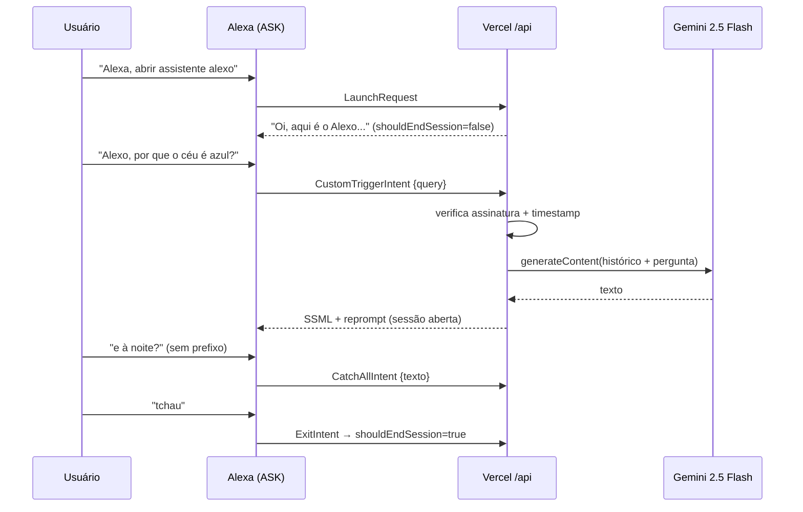

# Alexo — Alexa × Gemini 2.5 Flash (Vercel Serverless)

Skill personalizada da Alexa que funciona como interface de voz **conversacional e contínua**
conectada ao Google Gemini. Webhook HTTPS hospedado na Vercel (Node.js + TypeScript).



## Estrutura

| Arquivo | Função |
|---|---|
| [`package.json`](package.json) | Versões fixas de `ask-sdk-core`, `ask-sdk-express-adapter` (verificação de assinatura) e `@google/genai` |
| [`vercel.json`](vercel.json) | Rotas `/`, `/alexa` → `/api`; `maxDuration` 10s |
| [`tsconfig.json`](tsconfig.json) | Typecheck estrito (a Vercel compila o TS no build) |
| [`api/index.ts`](api/index.ts) | Handler: verificação, roteamento de intents, chamada ao Gemini, memória de sessão |
| [`skill-package/interactionModels/custom/pt-BR.json`](skill-package/interactionModels/custom/pt-BR.json) | Modelo de interação (colar no JSON Editor do Developer Console) |
| [`scripts/local-test.mts`](scripts/local-test.mts) | Simula uma requisição da Alexa localmente |

## Deploy

1. **GitHub**: crie o repositório e faça `git push`.
2. **Vercel**: *Add New → Project → Import* o repositório (framework: *Other*). Cada push na `main` gera deploy automático.
3. **Variáveis de ambiente** (Vercel → Settings → Environment Variables):
   - `GEMINI_API_KEY` — chave do [Google AI Studio](https://aistudio.google.com/apikey) (obrigatória)
   - `ALEXA_SKILL_ID` — `amzn1.ask.skill.…` (recomendado; preencha após criar a skill)
4. Teste: `GET https://<seu-projeto>.vercel.app/api` → `{"status":"ok",...}`.

## Configuração no Alexa Developer Console

1. *Create Skill* → nome "Alexo", idioma **Portuguese (BR)**, modelo **Custom**, hospedagem **Provision your own**.
2. *Interaction Model → JSON Editor*: cole o conteúdo de `pt-BR.json` → *Save* → *Build*.
3. *Endpoint* → **HTTPS** → `https://<seu-projeto>.vercel.app/api` →
   certificado: *"My development endpoint is a sub-domain of a domain that has a wildcard certificate from a certificate authority"*.
4. *Test* → habilite "Development" e fale/digite: `abrir assistente alexo`.

## Teste local

```bash
npm install
npm run typecheck
GEMINI_API_KEY=xxx npm run test:local -- "qual a capital da austrália"
npm run test:local -- tchau
```

## Como o "gatilho Alexo" funciona (e seus limites reais)

> [!IMPORTANT]
> A Alexa **não permite** que skills de terceiros registrem uma palavra de ativação própria.
> O hardware só acorda com as wake words oficiais (Alexa, Echo, Amazon, Computador…).
> Portanto "Alexo" funciona **dentro de uma sessão aberta** da skill, não como substituto de "Alexa" no estado ocioso.

Na prática:

- **Entrar**: `"Alexa, abrir assistente alexo"` ou, de uma vez, `"Alexa, pede pro assistente alexo me dizer por que o céu é azul"`.
  Dica: crie uma **Rotina** no app Alexa (frase personalizada, ex.: *"Alexa, Alexo"*) com ação *Skills → assistente alexo* para encurtar a abertura.
- **Durante a sessão**: `"Alexo, …"` é capturado pela `CustomTriggerIntent` (`AMAZON.SearchQuery`, que exige uma frase-portadora como "alexo") e
  frases sem prefixo caem na `CatchAllIntent` (slot customizado `CatchAllType`). O prefixo "Alexo" é removido antes de ir ao Gemini.
- **`AMAZON.FreeForm` não existe** como tipo público; o padrão usado aqui (SearchQuery + slot customizado com amostras variadas) é o substituto suportado.
- **Sessão contínua**: toda resposta usa `shouldEndSession: false` + reprompt. A Alexa ainda fecha a sessão
  se o usuário ficar ~8s em silêncio após o reprompt — isso não é configurável.
- **Encerramento**: `AMAZON.StopIntent`, `AMAZON.CancelIntent`, `ExitIntent` ("tchau", "sair", "parar"…) e um filtro regex no texto capturado.

## Latência

A Alexa aguarda no máximo ~8s pela resposta. Por isso: `thinkingBudget: 0` (desliga o raciocínio do 2.5 Flash),
`maxOutputTokens: 400`, timeout de 6s via `AbortController` (com mensagem amigável), resposta progressiva ("Hum.")
enviada em paralelo e histórico curto (6 turnos) nos atributos de sessão.

## Segurança

- Todas as requisições passam por `SkillRequestSignatureVerifier` + `TimestampVerifier` (exigência da Amazon para endpoints fora do Lambda).
- `SKIP_ALEXA_VERIFICATION=true` existe **apenas** para testes locais — nunca configure na Vercel.
- `ALEXA_SKILL_ID` impede que outras skills usem seu endpoint (e sua cota do Gemini).
